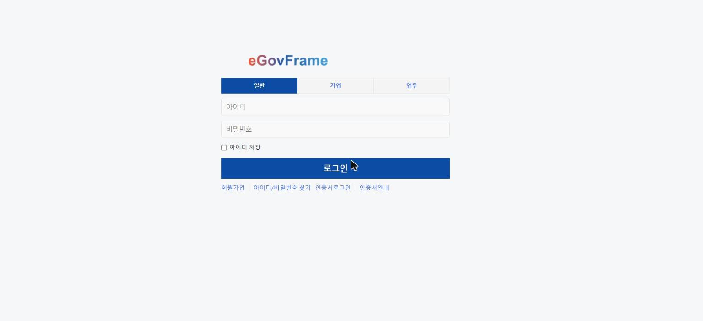
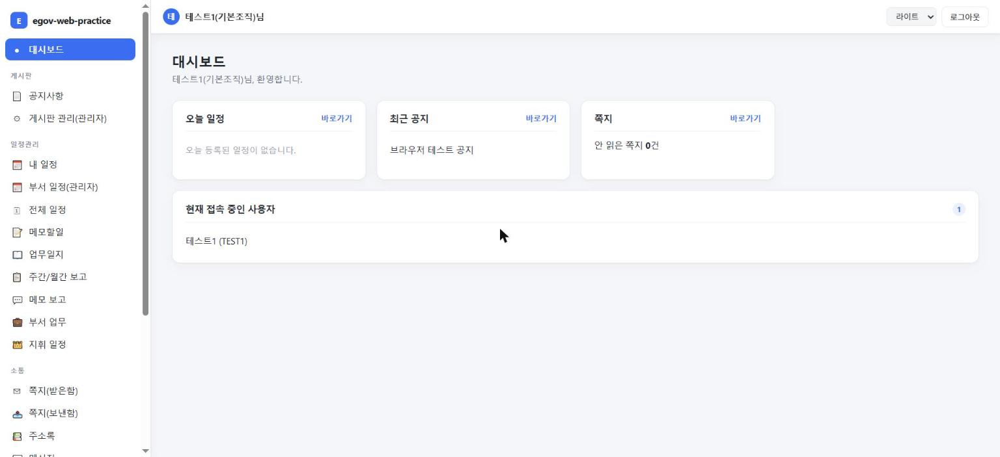
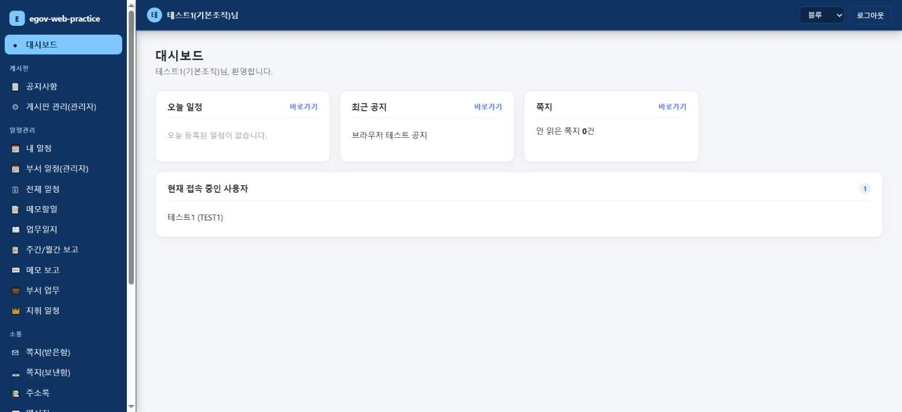

# 0. 화면 구성 둘러보기 (처음 보는 사람용)

> [메인 README](../../README.md) · 다음: [1. 현재 상태 한눈에](01_status_readme.md)

코드를 읽기 전에, 실제로 브라우저에 어떻게 보이는지부터 봅니다([새 PC 에서 시작하기](02_setup_readme.md) 안내대로 로그인하면 아래와 같은 화면이 뜹니다).

### 로그인 화면

상단 탭으로 사용자 구분(일반/기업/업무)을 고른 뒤 아이디·비밀번호를 입력합니다. 로컬 테스트 계정은
[02_setup_readme.md의 "로그인 정보"](02_setup_readme.md#3-로그인-정보)를 참고하세요.

### 로그인 후 기본 화면 (셸 + 대시보드)

로그인하면 `/shell.do`(포털 셸)로 이동합니다. 레이아웃은 세 부분으로 나뉩니다.

- **왼쪽 사이드바**: 게시판·일정관리·소통·메일·관리자 그룹으로 묶인 전체 메뉴. 클릭하면 오른쪽 iframe
  안에서만 화면이 바뀌고 사이드바는 고정됩니다(기존 ~150개 공통컴포넌트 JSP를 건드리지 않고 공통 틀을
  씌운 구조 — [6. 공통컴포넌트 도입 현황과 설계](06_components_readme.md) 참고).
- **상단 헤더**: 로그인한 사용자 이름, 테마 선택(라이트/다크/블루), 로그아웃.
- **가운데 대시보드**: 오늘 일정·최근 공지·안 읽은 쪽지·현재 접속 중인 사용자를 카드로 요약(15초마다
  접속자 수를 갱신).

### 테마 전환

헤더 오른쪽 드롭다운으로 라이트/다크/블루 3가지 테마를 바로 바꿀 수 있습니다(쿠키에 저장되어 다음 접속에도
유지됩니다). 테마는 셸(사이드바·헤더)에만 적용되고, iframe 안의 화면 자체(게시판·일정 등)는 아직
공통 스타일(`com.css`)만 적용되어 색상 테마를 따라 바꾸지는 않습니다.

> 더 많은 화면(게시판, 일정관리 달력, 쪽지, 메신저 등)은 로그인 후 사이드바에서 직접 눌러 보는 게 가장
> 빠릅니다. 메뉴 구성 전체 목록은 [6. 공통컴포넌트 도입 현황과 설계의 "화면 주소"](06_components_readme.md)를 참고하세요.

---
[메인 README](../../README.md) · 다음: [1. 현재 상태 한눈에](01_status_readme.md)
